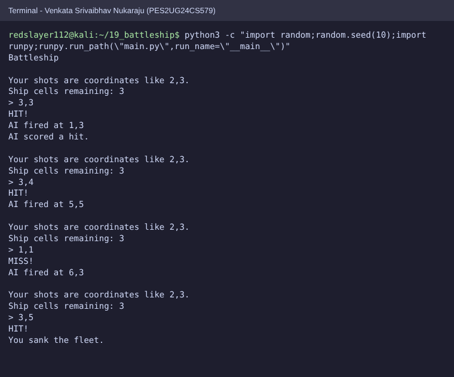
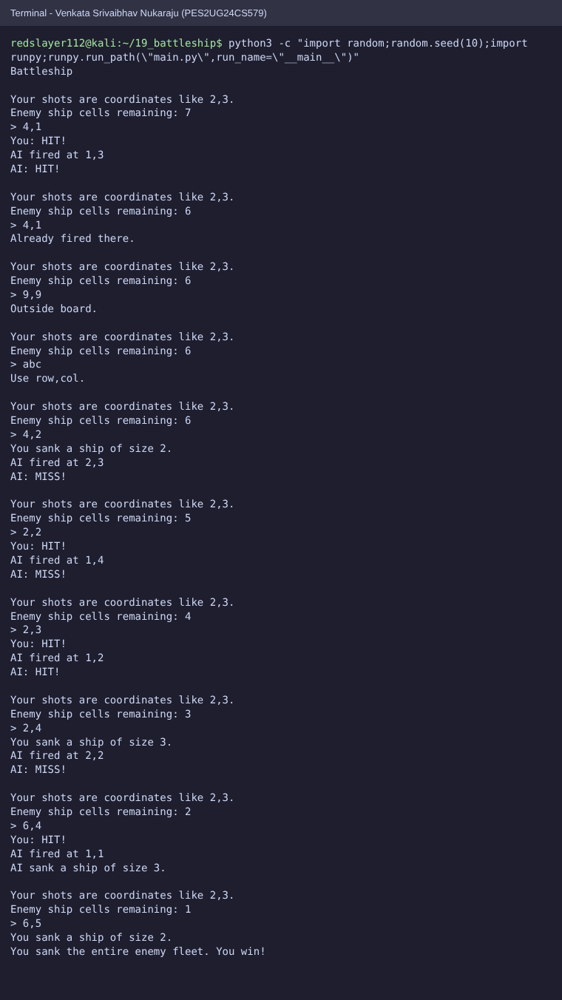

# SE Lab 4: Vibe Coding (Battleship vs AI)

**Venkata Srivaibhav Nukaraju | PES2UG24CS579 | 5-J**
**Assigned repo:** [SETAPESU26/19_battleship](https://github.com/SETAPESU26/19_battleship)
**Chat history (ChatGPT):** https://chatgpt.com/share/6ad07296-98d0-83ec-a4dd-e59007d04197

## Submission

| Deliverable | File |
|---|---|
| Updated code | [`19_battleship/`](19_battleship) |
| Report | [`PES2UG24CS579_SE_Lab4.pdf`](PES2UG24CS579_SE_Lab4.pdf) (source: [`.docx`](PES2UG24CS579_SE_Lab4.docx)) |
| Before / after screenshots | [`screenshots/`](screenshots) |
| Chat history | link above |

## Run

```bash
cd 19_battleship
python main.py
```

Shots are `row,col` (1-based, 6x6 board). `q` quits.

## Prompts and changes

| Prompt | Task | Change |
|---|---|---|
| 1 | Task 1: coordinates | AI returns 0-based tuples, AI shots land on the player board, counter and loss check fixed |
| 2 | Task 2: fleet and win | Three ships per side (3, 2, 2), per-ship damage, sunk messages, game ends when a fleet sinks |
| 3 | Tasks 3 and 4: AI and feedback | AI targets untried neighbours of hits, returns `None` on a full board, one message per real shot |

## Original defect

The AI returned 1-based strings and the game read them as 0-based tuples, so every AI shot
was one row and one column off and reported false hits. The ship counter subtracted the wrong
shot set and never dropped. The game loop stopped after the AI shot and never recorded it.

## Screenshots

| Before | After |
|---|---|
|  |  |

Both runs use `random.seed(10)`, so the AI's first shot is 1,3 in each: a false hit before, a
real hit after. [`after_quit.png`](screenshots/after_quit.png) shows invalid input and quitting.
